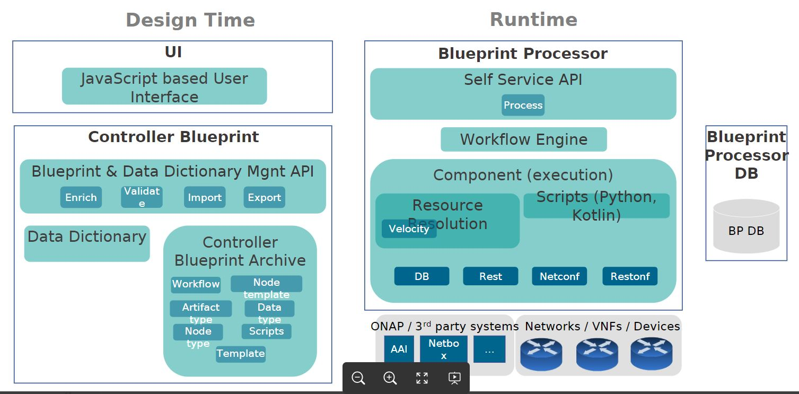

# Controller Design Studio (CDS)

CDS is the ONAP component for designing and running network automation
without code changes in ONAP itself. Designers package models, resource
dictionaries, templates and scripts into a Controller Blueprint Archive (CBA);
the blueprints processor deploys the CBA and executes its workflows (resource
resolution, configuration through NETCONF, RESTCONF, CLI, Ansible or scripts)
over REST, gRPC or Kafka.



## Repository layout

| Path | Content |
|------|---------|
| `ms/blueprintsprocessor/` | Blueprints processor runtime (Kotlin, Spring Boot) and its modules and executor functions |
| `ms/sdclistener/` | Listener that receives SDC distributions and uploads the contained CBAs |
| `ms/py-executor/`, `ms/command-executor/`, `ms/artifact-manager/` | Python services for remote script execution and artifact management |
| `ms/error-catalog/` | Shared error catalog |
| `cds-ui/` | CDS Designer UI: Angular front ends, LoopBack backend for the UI, image packaging and Playwright tests, see [cds-ui/README.md](./cds-ui/README.md) |
| `components/` | Model catalog (TOSCA types, sample and test blueprints), CBA parent POM and the Python script libraries available to CBAs |
| `py-modules/` | Common Python package with the CDS protobuf and gRPC definitions |
| `docs/` | Sources of the published documentation |

## Build and test

Requirements: JDK 17 or 21 (the code targets Java 17, CI builds with
JDK 21), Maven 3.8 or newer, and the ONAP Maven `settings.xml` to resolve
ONAP artifacts. The cds-ui modules download their own Node.js and npm during
the Maven build.

```bash
mvn clean install                  # build everything and run the tests
mvn clean install -DskipTests      # build without tests
mvn clean install -Pdocker         # also build the Docker images
mvn process-sources -P format      # format Kotlin sources with ktlint
```

Python services are tested with tox, for example:

```bash
cd ms/py-executor && tox -e py38
```

Documentation:

```bash
cd docs && tox -e docs
```

## Documentation

- [CDS documentation](https://docs.onap.org/projects/onap-ccsdk-cds/en/latest/index.html)
- [Developer guide](https://docs.onap.org/projects/onap-ccsdk-cds/en/latest/userguides/developer-guide/index.html)
- [Release notes](https://docs.onap.org/projects/onap-ccsdk-cds/en/latest/release-notes.html)

Changes are reviewed on [ONAP Gerrit](https://gerrit.onap.org/r/q/project:ccsdk/cds)
and tracked in the CCSDK project on [ONAP Jira](https://lf-onap.atlassian.net/projects/CCSDK).
